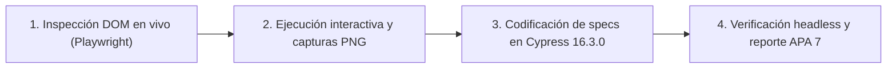
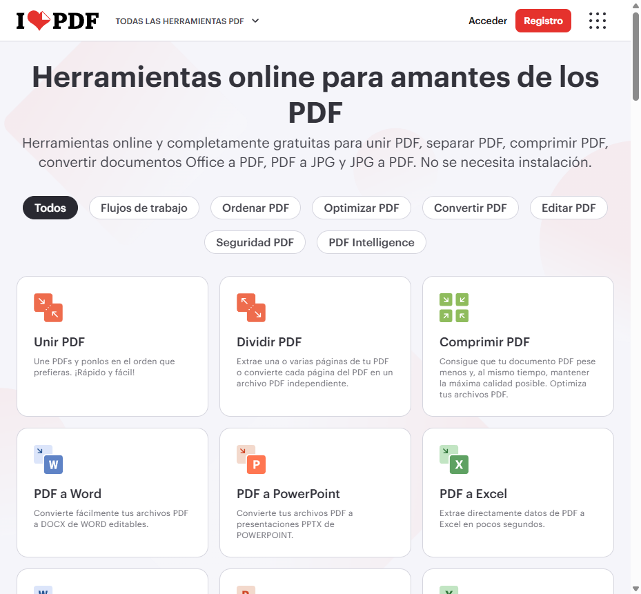
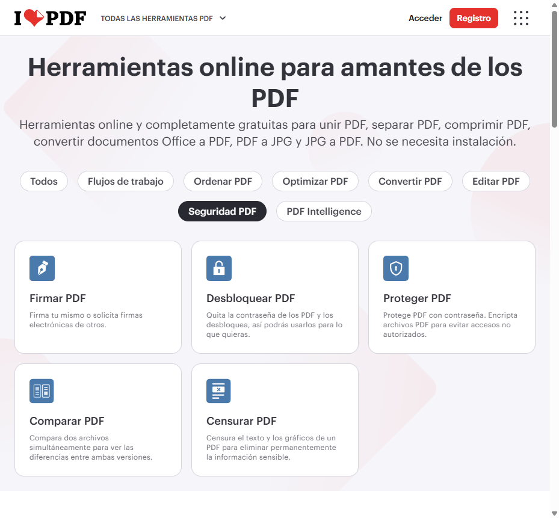
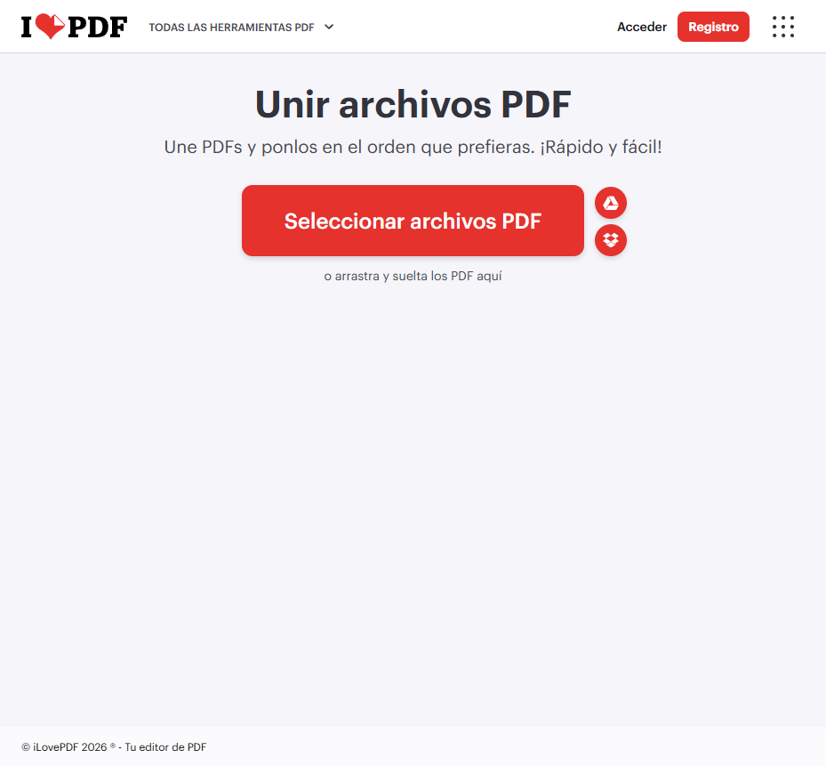
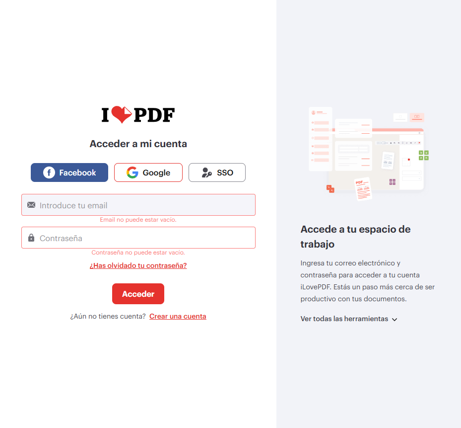
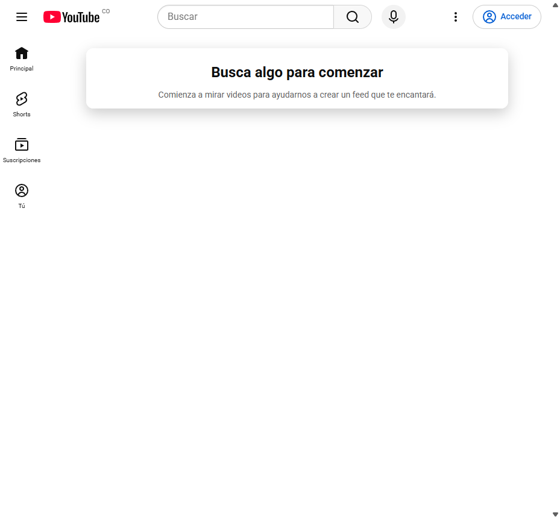
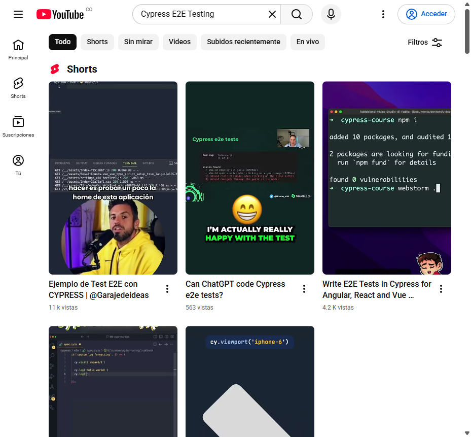
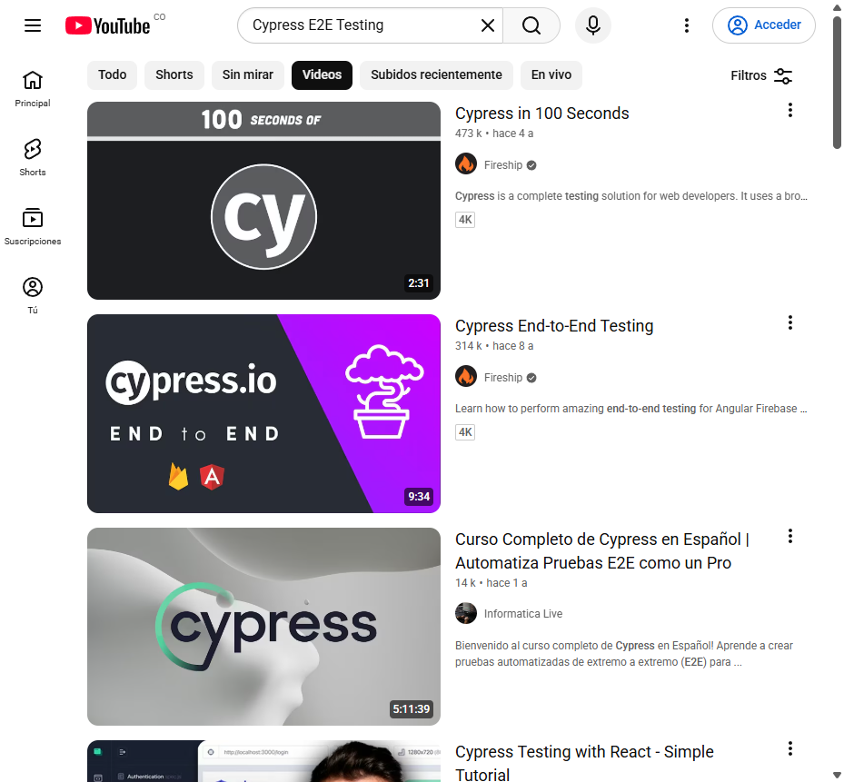
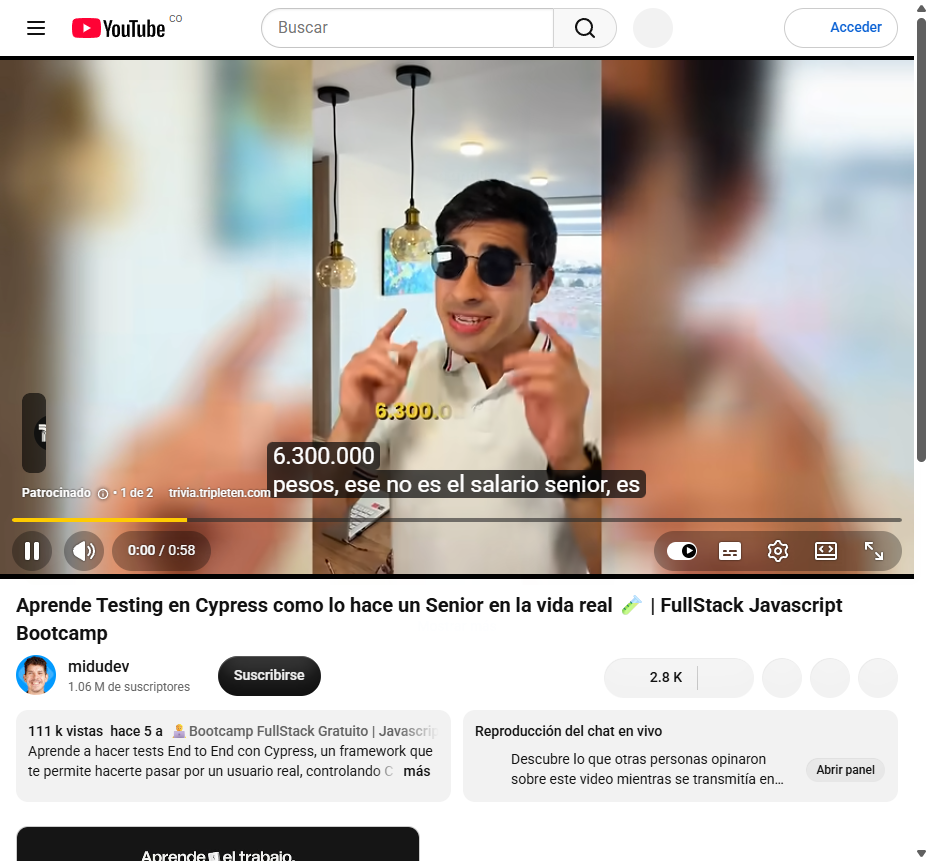

# Pruebas Automatizadas End-to-End (E2E) con Cypress y Playwright

Suite de pruebas automatizadas End-to-End (E2E) y documentación técnica paso a paso sobre aplicaciones web de producción (**iLovePDF** y **YouTube**), combinando **Playwright MCP** para la inspección en vivo del DOM y captura de evidencias visuales con **Cypress 16.3.0** para la ejecución automatizada de especificaciones.

## Resumen de resultados

| Plataforma | URL Base | Casos Evaluados | Spec de Cypress | Tiempo | Estado |
| :--- | :--- | :---: | :--- | :---: | :---: |
| **iLovePDF (ES)** | `https://www.ilovepdf.com/es` | 4 | [`cypress/e2e/ilovepdf.cy.js`](cypress/e2e/ilovepdf.cy.js) | 10 s | `4/4 PASS` |
| **YouTube** | `https://www.youtube.com` | 4 | [`cypress/e2e/youtube.cy.js`](cypress/e2e/youtube.cy.js) | 24 s | `3/3 PASS` |

---

## Inicio rápido

1. **Instalar dependencias:**
   ```bash
   npm install
   ```
2. **Ejecutar todas las pruebas en modo headless (consola):**
   ```bash
   npm run cy:run
   ```
3. **Abrir la interfaz interactiva de Cypress:**
   ```bash
   npm run cy:open
   ```

---

## Metodología del proceso de pruebas

El flujo de aseguramiento de calidad (QA) se dividió en cuatro etapas secuenciales para garantizar selectores estables y trazabilidad visual de cada escenario:



1. **Reconocimiento del árbol de accesibilidad (Playwright MCP):** Antes de escribir código, se navegó cada URL objetivo extrayendo snapshots del DOM para identificar encabezados semánticos (`h1`, `h2`, `h3`), roles ARIA (`combobox`, `tab`, `button`) y atributos estables (`input[name="search_query"]`, `#movie_player`).
2. **Aislamiento de errores de terceros:** Dado que portales de alto tráfico cargan scripts analíticos y publicitarios externos, se configuró `Cypress.on('uncaught:exception', () => false)` en el bloque `beforeEach` de cada suite para evitar falsos negativos ajenos al flujo funcional.
3. **Captura de evidencias paso a paso:** Cada transición de estado se registró en la carpeta [`screenshots/`](screenshots/) en formato PNG.
4. **Automatización reproducible en Cypress:** Los flujos validados se codificaron en [`cypress/e2e/`](cypress/e2e/) y se verificaron mediante `npx cypress run`.

---

## Procesos de las pruebas detallados

### 1. Suite iLovePDF (`https://www.ilovepdf.com/es`)

Archivo de especificación: [`cypress/e2e/ilovepdf.cy.js`](cypress/e2e/ilovepdf.cy.js)

| ID | Proceso de prueba | Pasos ejecutados | Verificación esperada |
| :--- | :--- | :--- | :--- |
| **ILP-01** | **Carga de página principal y catálogo PDF** | 1. Visitar `/es`.<br>2. Localizar encabezado `<h1>`.<br>3. Inspeccionar grilla de tarjetas `<h3>`. | El título contiene *"Herramientas online para amantes de los PDF"* y las tarjetas **Unir PDF**, **Dividir PDF** y **Comprimir PDF** son visibles. |
| **ILP-02** | **Filtrado dinámico por categoría de seguridad** | 1. En la portada, accionar la pestaña de filtro **Seguridad PDF**.<br>2. Evaluar la actualización de tarjetas en el DOM sin recarga de página. | Se muestran en pantalla las herramientas **Desbloquear PDF**, **Proteger PDF** y **Firmar PDF**. |
| **ILP-03** | **Espacio de trabajo de la herramienta Unir PDF** | 1. Navegar a `/es/unir_pdf`.<br>2. Validar encabezado `<h1>` del módulo.<br>3. Comprobar controles de subida local y nube. | Se renderiza el título *"Unir archivos PDF"* junto con el botón activo **Seleccionar archivos PDF** y los conectores de Google Drive y Dropbox. |
| **ILP-04** | **Validación de campos vacíos en inicio de sesión** | 1. Navegar a `/es/login`.<br>2. Dejar en blanco los campos de correo y contraseña.<br>3. Hacer clic en el botón **Acceder**. | El formulario impide el envío y despliega los mensajes de validación *"Email no puede estar vacío."* y *"Contraseña no puede estar vacío."*. |

#### Evidencias visuales — iLovePDF

| ILP-01: Catálogo principal | ILP-02: Filtro Seguridad PDF |
| :---: | :---: |
|  |  |

| ILP-03: Herramienta Unir PDF | ILP-04: Validación de Login |
| :---: | :---: |
|  |  |

---

### 2. Suite YouTube (`https://www.youtube.com`)

Archivo de especificación: [`cypress/e2e/youtube.cy.js`](cypress/e2e/youtube.cy.js)

| ID | Proceso de prueba | Pasos ejecutados | Verificación esperada |
| :--- | :--- | :--- | :--- |
| **YT-01** | **Carga de portada, banner y buscador** | 1. Visitar `https://www.youtube.com`.<br>2. Verificar título del documento.<br>3. Inspeccionar barra superior y caja de búsqueda. | El título incluye *"YouTube"* y el campo `input[name="search_query"]` se encuentra visible y habilitado. |
| **YT-02** | **Ejecución de búsqueda automatizada** | 1. Consultar `/results?search_query=Cypress+E2E+Testing`.<br>2. Validar persistencia del texto en el buscador.<br>3. Esperar hidratación de Web Components. | El buscador conserva el valor `"Cypress E2E Testing"` y se renderizan nodos `<ytd-video-renderer>` y `<ytd-reel-shelf-renderer>`. |
| **YT-03** | **Filtrado por pestaña de Videos** | 1. Localizar la barra de filtros (`role="tablist"`).<br>2. Seleccionar la pestaña **Videos** (`role="tab"`). | El listado filtra los resultados mostrando únicamente videos de formato completo con miniatura, duración y canal. |
| **YT-04** | **Página de reproducción y reproductor HTML5** | 1. Abrir la ruta de visualización `/watch?v=HDFNjDKKO6A`.<br>2. Esperar el montaje del contenedor multimedia.<br>3. Inspeccionar controles de reproducción. | El elemento `#movie_player` y la etiqueta `<video>` existen en el DOM con sus controles de reproducción, volumen y pantalla completa. |

#### Evidencias visuales — YouTube

| YT-01: Página principal | YT-02: Resultados de búsqueda |
| :---: | :---: |
|  |  |

| YT-03: Filtro de pestaña Videos | YT-04: Reproductor de video HTML5 |
| :---: | :---: |
|  |  |

---

## Estructura del repositorio

```text
├── cypress/
│   ├── e2e/
│   │   ├── ilovepdf.cy.js      # Suite automatizada de pruebas para iLovePDF
│   │   └── youtube.cy.js       # Suite automatizada de pruebas para YouTube
│   ├── fixtures/
│   │   └── example.json        # Datos de prueba base de Cypress
│   └── support/
│       ├── commands.js         # Comandos personalizados de Cypress
│       └── e2e.js              # Configuración global de soporte E2E
├── docs/
│   ├── Informe_Pruebas_Cypress_Playwright_APA7.docx  # Informe en Word con normas APA 7
│   └── test-report.md                                # Informe técnico en formato Markdown
├── screenshots/                # Evidencias visuales capturadas paso a paso (PNG)
├── Informe_Pruebas_Cypress_Playwright_APA7.docx      # Copia en raíz del informe APA 7
├── cypress.config.js           # Configuración principal de Cypress 16.3.0
└── package.json                # Dependencias y scripts (cy:run, cy:open)
```

## Documentación e informes incluidos

- **Informe en Microsoft Word (Normas APA 7.ª edición):** [`Informe_Pruebas_Cypress_Playwright_APA7.docx`](Informe_Pruebas_Cypress_Playwright_APA7.docx)
- **Informe técnico en Markdown:** [`docs/test-report.md`](docs/test-report.md)
