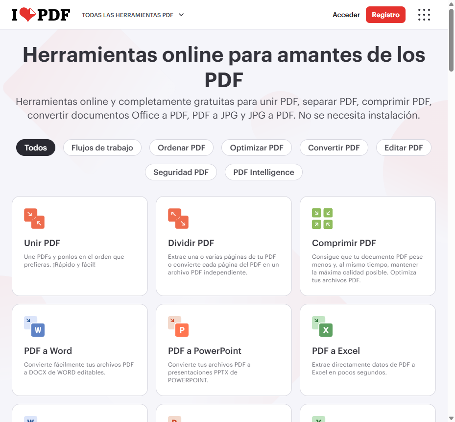
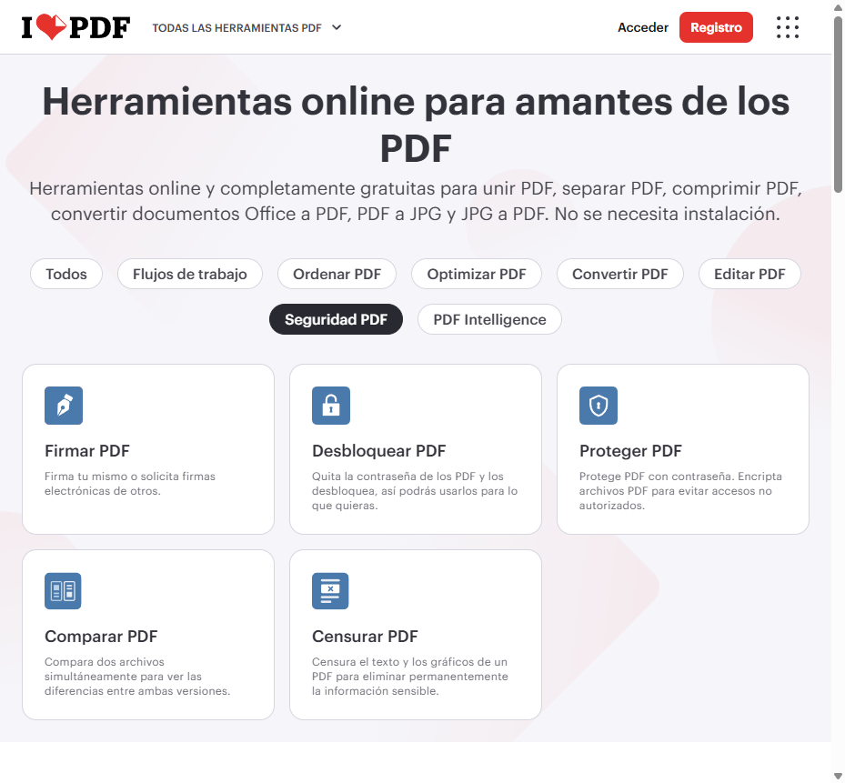
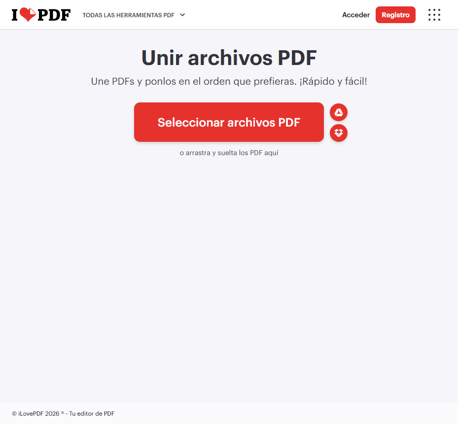
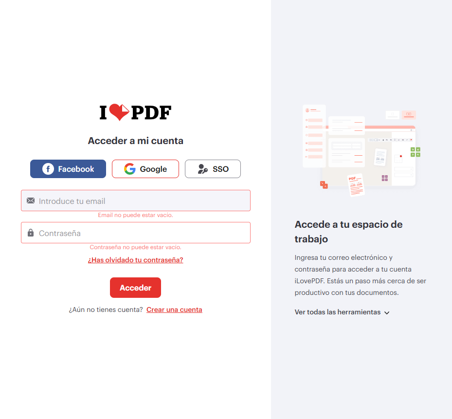
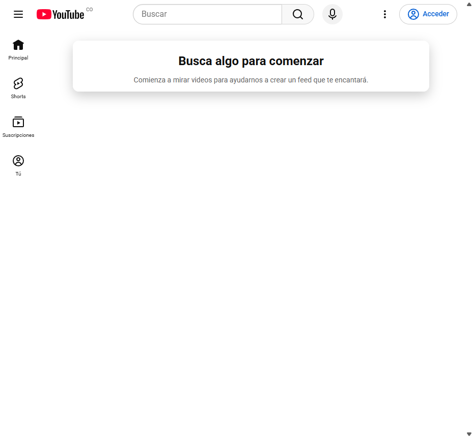
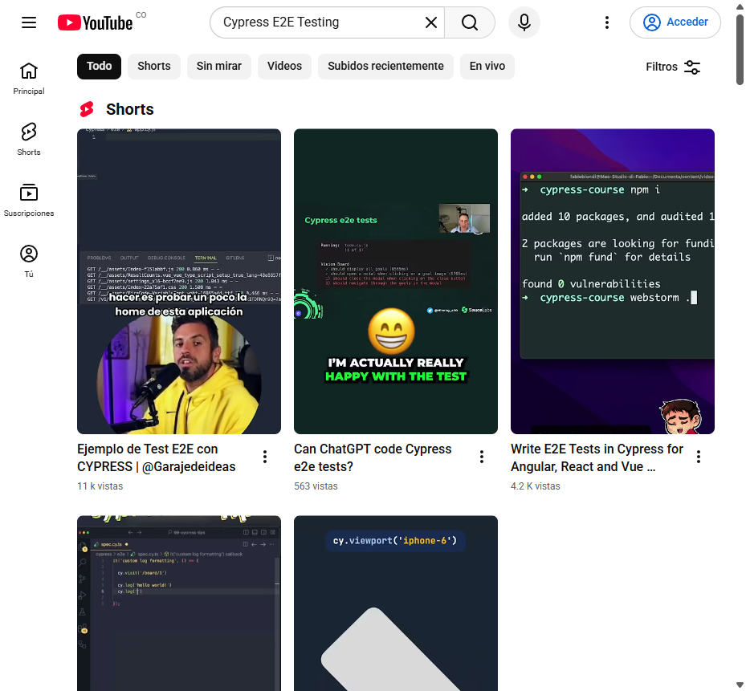
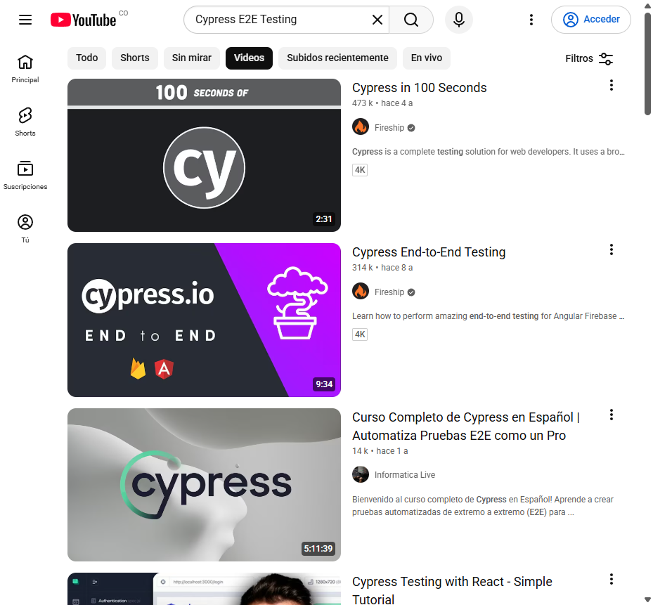

# E2E Test Execution Report — iLovePDF & YouTube

End-to-end functional verification of **iLovePDF (`https://www.ilovepdf.com/es`)** and **YouTube (`https://www.youtube.com`)** executed with **Playwright MCP** (live browser inspection & screenshot capture) and automated in **Cypress 16.3.0** ([ilovepdf.cy.js](../cypress/e2e/ilovepdf.cy.js), [youtube.cy.js](../cypress/e2e/youtube.cy.js)).

## Executive Summary

| Target Application | Base URL | Flows Verified | Playwright Live | Cypress E2E Spec | Status |
| :--- | :--- | :---: | :---: | :--- | :---: |
| **iLovePDF (ES)** | `https://www.ilovepdf.com/es` | 4 | PASS | `cypress/e2e/ilovepdf.cy.js` (4/4) | PASS |
| **YouTube** | `https://www.youtube.com` | 4 | PASS | `cypress/e2e/youtube.cy.js` (3/3) | PASS |

## Quick Path — Run Automated Tests Locally

1. Run all headless E2E suites:
   ```bash
   npm run cy:run
   ```
2. Or launch the interactive Cypress runner:
   ```bash
   npm run cy:open
   ```

---

## 1. iLovePDF (`https://www.ilovepdf.com/es`)

### Flow Summary & Verified Assertions

| Flow ID | Flow Name | Target URL | Key Selectors / Elements Verified | Result |
| :--- | :--- | :--- | :--- | :---: |
| **ILP-01** | Homepage & Core Tool Grid | `/es` | `h1` (`Herramientas online para amantes de los PDF`), `h3` cards (`Unir PDF`, `Dividir PDF`, `Comprimir PDF`) | PASS |
| **ILP-02** | Category Tab Filtering | `/es` | Category filter `Seguridad PDF` -> displays `Desbloquear PDF`, `Proteger PDF`, `Firmar PDF` | PASS |
| **ILP-03** | Merge PDF Tool Workspace | `/es/unir_pdf` | `h1` (`Unir archivos PDF`), upload CTA `a` (`Seleccionar archivos PDF`), Google Drive & Dropbox triggers | PASS |
| **ILP-04** | Login Empty-Form Validation | `/es/login` | Submit `button` (`Acceder`) with empty inputs -> triggers `Email no puede estar vacío.` & `Contraseña no puede estar vacío.` | PASS |

### Captured Evidence — iLovePDF

#### ILP-01: Homepage & Tool Catalog


#### ILP-02: Category Filter (`Seguridad PDF`)


#### ILP-03: Merge PDF Tool (`/es/unir_pdf`)


#### ILP-04: Login Validation (`/es/login`)


---

## 2. YouTube (`https://www.youtube.com`)

### Flow Summary & Verified Assertions

| Flow ID | Flow Name | Target URL | Key Selectors / Elements Verified | Result |
| :--- | :--- | :--- | :--- | :---: |
| **YT-01** | Homepage & Navigation Banner | `/` | Page title `YouTube`, guide button (`Guía`), search combobox `input[name="search_query"]` | PASS |
| **YT-02** | Search Query Execution | `/results?search_query=Cypress+E2E+Testing` | Search input value `Cypress E2E Testing`, rendered `ytd-video-renderer` & `ytd-reel-shelf-renderer` items | PASS |
| **YT-03** | Content Type Tab Filter | `/results?search_query=Cypress+E2E+Testing` | Filter tab `Videos` (`role="tab"`) narrows results to full-length videos | PASS |
| **YT-04** | Video Watch Page & Player | `/watch?v=HDFNjDKKO6A` | HTML5 video container `#movie_player` / `video`, playback controls (`Reproducir (k)`, `Silenciar (m)`, `Pantalla completa (f)`) | PASS |

### Captured Evidence — YouTube

#### YT-01: YouTube Homepage


#### YT-02: Search Results (`Cypress E2E Testing`)


#### YT-03: Videos Tab Filter


#### YT-04: Video Player Watch Page


---

## Verification Checklist

- [x] Live DOM inspection and flow execution completed via Playwright MCP.
- [x] Viewport screenshots captured for all 8 verification checkpoints in `screenshots/`.
- [x] Automated Cypress E2E test suites implemented in `cypress/e2e/ilovepdf.cy.js` and `cypress/e2e/youtube.cy.js`.
- [x] All Cypress E2E specs executed and passing in headless mode.
